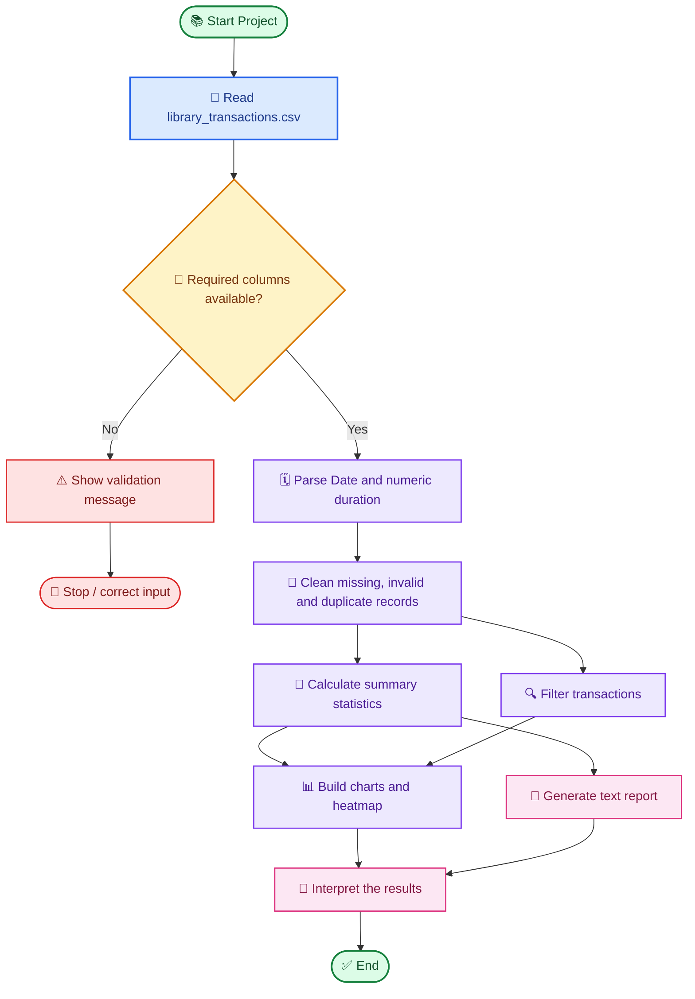

<div align="center">


# 📚 E-LIBRARY DATA ANALYSIS DASHBOARD

### <span style="color:#7C3AED;">A Complete Python Project for Library Transaction Analysis</span>

<p>
  
  
  
  
  
  
</p>

**Explore borrowing behaviour • Discover trends • Summarise library activity**

*A data-analysis project that transforms raw e-library transaction records into useful statistics, filtered datasets, visual charts, and a readable report.*

</div>

---

## 📑 Table of Contents

- [🌟 Introduction](#-introduction)
- [🎯 Problem Statement](#-problem-statement)
- [🎯 Objectives](#-objectives)
- [🧰 Technology Stack](#-technology-stack)
- [📁 Project Structure](#-project-structure)
- [🗃️ Dataset Documentation](#️-dataset-documentation)
- [🔄 Workflow and Architecture](#-workflow-and-architecture)
- [⚙️ Detailed Features](#️-detailed-features)
- [📊 Visualisation Guide](#-visualisation-guide)
- [📈 Statistics and Business Meaning](#-statistics-and-business-meaning)
- [🚀 Installation and Execution](#-installation-and-execution)
- [🧪 Validation and Data Quality](#-validation-and-data-quality)
- [📋 Sample Results](#-sample-results)
- [🧠 Python Concepts Demonstrated](#-python-concepts-demonstrated)
- [👩‍💻 Author](#-author)

---

## 🌟 Introduction

The **E-Library Data Analysis Dashboard** is a Python project created to examine borrowing transactions recorded by a digital library. Each row in the dataset represents a transaction and contains information about the user, book, genre, date, time, and borrowing duration.

Libraries can collect a large amount of transaction data, but raw records alone do not immediately reveal which books are popular, which genres receive more attention, or when borrowing activity is highest. This project organises and analyses the data to make these patterns easier to understand.

The project uses **Pandas** for data manipulation, **NumPy** for numerical calculations, **Matplotlib** for charts, and **Seaborn** for a heatmap. Its analysis logic is organised around a `LibraryDashboard` class, while the Jupyter Notebook provides an interactive way to inspect the data and view visual outputs.

> **Project type:** Python • Data Analysis • Object-Oriented Programming • Data Visualisation

## 🎯 Problem Statement

Raw library transaction data is difficult to interpret manually. Without analysis, it can be challenging to identify frequently borrowed books, compare genre popularity, examine monthly changes, detect the busiest day, or understand borrowing-duration patterns.

This project addresses that problem by loading transaction records from a CSV file, checking and cleaning the data, calculating statistics, applying filters, and presenting findings in charts and a summary report.

## 🎯 Project Objectives

1. Import transaction data from a CSV file into a Pandas DataFrame.
2. Validate the presence of expected columns before analysis.
3. Convert date and borrowing-duration columns into suitable data types.
4. Handle incomplete or invalid rows and duplicate transaction IDs.
5. Calculate transaction counts, unique users, unique books, average duration, and other summary statistics.
6. Identify the five most frequently borrowed book titles.
7. Filter transactions by genre, date range, and minimum borrowing duration.
8. Visualise book popularity, monthly trends, genre distribution, borrowing duration, and day/hour activity.
9. Generate a readable text report.
10. Keep the project organised with a Python script, notebook, CSV dataset, and README documentation.

## 🧰 Technology Stack

| Tool / Library | Role in the Project | How It Helps |
|---|---|---|
| **Python 3** | Core language | Implements the analysis logic and project workflow |
| **Pandas** | Data processing | Reads CSV data, handles DataFrames, filters rows, groups records, and counts values |
| **NumPy** | Numerical analysis | Calculates numeric measures such as standard deviation |
| **Matplotlib** | Data visualisation | Creates bar charts, line graphs, pie charts, and histograms |
| **Seaborn** | Heatmap visualisation | Displays activity intensity in a grid |
| **Jupyter Notebook** | Interactive analysis | Runs code cell by cell and displays results inline |
| **Visual Studio Code** | Development environment | Edits the notebook and Python script and provides a terminal |

## 📁 Project Structure

```text
E-library-data/
│
├── library_dashboard.py
│   └── Python script containing the dashboard class and analysis workflow
│
├── library_dashboard.ipynb
│   └── Interactive notebook containing data exploration, analysis and charts
│
├── library_transactions.csv
│   └── Source dataset containing library borrowing transactions
│
└── README.md
    └── Project overview, workflow, documentation and run instructions
```

**Why keep both a `.py` file and an `.ipynb` file?**

- The **Python script** is useful for running the project from the terminal as a program.
- The **Jupyter Notebook** is useful for step-by-step exploration and showing charts and intermediate outputs.
- The **CSV file** provides the data that the script and notebook analyse.
- The **README** explains the purpose, setup, features, workflow, and usage to anyone viewing the GitHub repository.

Keep the Python script and CSV file in the same project folder unless the script is configured to use a different dataset path.

## 🗃️ Dataset Documentation

The source file is `library_transactions.csv`. The project dataset used during development contains **30 transaction records** and **7 columns** before cleaning. The current notebook run retained 30 valid transactions.

| Column | Expected Meaning | Example Format |
|---|---|---|
| `Transaction ID` | Identifier for one borrowing transaction | `T001` or another transaction code |
| `Date` | Date of the transaction | `2026-01-05` |
| `User ID` | Identifier of the library user | `U001` |
| `Book Title` | Title of the borrowed book | `Python Basics` |
| `Genre` | Genre/category of the book | `Fantasy` |
| `Borrowing Duration (Days)` | Borrowing duration measured in days | `7` |
| `Time` | Time at which the transaction occurred | `10:30` |

*The values above illustrate the expected formats; the actual values are read from the supplied CSV file.*

### Data types

- `Date` should be parsed as a datetime field so that date comparisons and month-based grouping work correctly.
- `Borrowing Duration (Days)` should be numeric so that average and standard-deviation calculations are meaningful.
- Text fields such as book title, genre, user ID, and transaction ID are used for identification and grouping.
- `Time` can be converted to a time or hour field when analysing activity by time of day.

## 🔄 Workflow and Architecture

The diagram below shows the main data path from the CSV input to the final report and visualisations.



### Workflow explained step by step

1. **Input:** Read the transaction CSV file.
2. **Validation:** Confirm that the required columns exist. If a required column is missing, the program should report the issue instead of continuing as though the dataset were valid.
3. **Type conversion:** Convert dates to datetime values and borrowing durations to numeric values.
4. **Cleaning:** Remove unusable records and duplicate transaction IDs according to the cleaning rules in the code.
5. **Analysis:** Calculate overall metrics and rank books by transaction count.
6. **Filtering:** Select a subset of transactions using optional filter criteria.
7. **Visualisation:** Build charts that communicate patterns in the data.
8. **Reporting:** Print the principal statistics and top-book summary.

## ⚙️ Detailed Features

### 1. CSV loading and validation

The dashboard loads the dataset with Pandas. It checks whether expected columns are present, then prepares the date and borrowing-duration fields for analysis.

**Why it matters:** A missing or incorrectly typed column can cause inaccurate calculations or runtime errors. Validating the input early helps make the workflow more reliable.

### 2. Data cleaning

The current implementation is designed to:

- Convert dates to datetime values.
- Convert borrowing duration to numeric values.
- Drop rows that are missing required values.
- Remove repeated transaction IDs.
- Exclude negative borrowing durations.

During the recorded test run, the dataset contained 30 rows and no missing values or duplicate transaction IDs, so all 30 transactions remained after cleaning.

### 3. Summary statistics

The dashboard computes core metrics from the valid transaction data.

| Metric | Meaning |
|---|---|
| Total Transactions | Number of valid transaction records |
| Unique Users | Count of distinct user IDs |
| Unique Books | Count of distinct book titles |
| Average Borrowing Duration | Mean duration in days |
| Top 5 Borrowed Books | Five book titles with the highest record counts |
| Standard Deviation | Measure of variation in borrowing duration |
| Busiest Day | Date with the highest number of transaction records |

### 4. Transaction filtering

The `filter_transactions()` functionality is intended to create a filtered copy of the transaction DataFrame. Optional conditions can be applied to narrow the dataset.

| Filter | Purpose | Example |
|---|---|---|
| Genre | Keep transactions from a chosen genre | `Fantasy` |
| Start date | Keep transactions on or after a specified date | `2026-01-01` |
| End date | Keep transactions on or before a specified date | `2026-01-31` |
| Borrowing duration | Keep transactions whose duration meets a minimum threshold | At least 5 days |

**Example use in the notebook, once the method is available on the class:**

```python
filtered_data = library.filter_transactions(genre="Fantasy")

print(filtered_data[["Book Title", "Genre"]])
print("Total transactions:", len(filtered_data))
```

The filtering method must be defined **inside** the `LibraryDashboard` class for the call above to work. In the supplied test dataset, filtering Fantasy transactions returned 6 records.

### 5. Report generation

The report prints the project title and core measures, including:

- Total transactions.
- Unique users.
- Unique books.
- Average borrowing duration.
- Top five borrowed books.

This provides a quick text-based summary without requiring the reader to inspect every chart.

## 📊 Visualisation Guide

Visualisations help turn numerical results into patterns that are easier to communicate.

### 📊 Top 5 Most Borrowed Books — Bar Chart

**Question answered:** Which book titles appear most often in the transaction records?

- The horizontal axis represents book titles.
- The vertical axis represents borrowing transaction counts.
- Taller bars indicate more transactions for that title.

**Use:** Helps identify popular titles and may help inform collection planning. A transaction count indicates recorded borrowing activity, not necessarily the number of physical copies owned.

### 📈 Monthly Borrowing Trends — Line Graph

**Question answered:** How many borrowing transactions were recorded in each month?

- The horizontal axis represents month.
- The vertical axis represents the number of transactions.
- The line helps show increases, decreases, and changes over time.

**Use:** Helps compare activity across the months represented in the dataset. Conclusions should be limited to the period available in the CSV.

### 🥧 Borrowing by Genre — Pie Chart

**Question answered:** What share of all recorded transactions belongs to each genre?

- Each slice represents a genre.
- The slice size and percentage show its share of the total transaction count.

**Use:** Makes it easier to compare the relative popularity of genres within the dataset.

### 🔥 Borrowing Activity — Heatmap

**Question answered:** At what times or on which days is recorded activity relatively high?

A heatmap uses a grid of coloured cells to represent counts or intensity. Darker or more saturated cells typically indicate higher counts, depending on the colour scale.

**Important:** The heatmap should use a weekday/day field and an hour-of-day field if the requirement is to analyse activity by day and time. A heatmap grouped by genre and month answers a different question. The chart should be described according to the fields actually used in the notebook.

### 📉 Borrowing Duration — Histogram

**Question answered:** How are transaction durations distributed?

- The horizontal axis shows borrowing duration in days.
- The vertical axis shows the number of transactions in each duration interval.

**Use:** Shows common duration ranges and whether unusually short or long borrowing durations appear in the data.

### 📊 Genre-wise Borrowing — Bar Chart

**Question answered:** How many transactions belong to each genre?

This chart compares genre counts directly. It is useful when precise comparisons between categories are more important than showing percentages.

## 📈 Statistics and Business Meaning

The figures below were observed during the current notebook test run.

| Measure | Observed Value | Interpretation |
|---|---:|---|
| Valid Transactions | 30 | 30 transaction records remained after validation and cleaning |
| Unique Users | 11 | 11 distinct user IDs appeared in the dataset |
| Unique Books | 9 | 9 distinct book titles appeared in the dataset |
| Average Borrowing Duration | 6.2 days | The mean recorded borrowing duration was 6.2 days |
| Standard Deviation | Approximately 1.85 days | Borrowing durations showed some variation around their mean |
| Busiest Recorded Day | 2026-01-05 | This date had the highest transaction count in the test run |

The top five titles observed in the notebook output were:

| Book Title | Transaction Count |
|---|---:|
| Python Basics | 5 |
| Data Science | 4 |
| Harry Potter | 3 |
| The Alchemist | 3 |
| Atomic Habits | 3 |


## 🧪 Validation and Data Quality

Data validation helps prevent misleading results. The project checks the expected schema and prepares key fields before computing statistics.
## 📋 Sample Results

An example of the report output format is shown below. The values correspond to the dataset used during the recorded test run.

```text
E-Library Data Analysis Report
-----------------------------------
Total Transactions: 30
Unique Users: 11
Unique Books: 9
Average Borrowing Duration: 6.2

Top 5 Borrowed Books:
Python Basics     5
Data Science      4
Harry Potter      3
The Alchemist     3
Atomic Habits     3
```

The exact formatting and displayed statistics may vary depending on the current implementation and dataset.

## 🧠 Python Concepts Demonstrated

This project provides practice with several foundational Python and data-analysis concepts.

### Object-Oriented Programming (OOP)

The `LibraryDashboard` class groups related data and operations in one place. Its methods are intended to handle tasks such as initialisation, loading data, calculating statistics, filtering transactions, and generating a report.

### File Handling

The project reads a CSV file from disk. The input file must be available at the path used by the code.

### Exception Handling

A `try` / `except` block can handle expected problems, such as a missing CSV file, and display a useful error message instead of allowing the program to stop without explanation.

### Pandas DataFrames

A DataFrame stores tabular records in rows and columns. Pandas operations support filtering, grouping, counting, date conversion, duplicate removal, and descriptive analysis.

### NumPy Calculations

NumPy supports numerical calculations such as standard deviation. For example:

```python
np.std(library.df["Borrowing Duration (Days)"])
```

This calculates the population standard deviation by default (`ddof=0`). Use `ddof=1` if the sample standard deviation is required.

### Data Visualisation

Matplotlib and Seaborn turn calculated counts into visual summaries that are easier to inspect and explain.


## ▶️ Quick Summary

| Stage | Input / Action | Output |
|---|---|---|
| 1. Load | Read the transaction CSV | DataFrame |
| 2. Validate | Check schema and field types | Prepared data |
| 3. Clean | Handle unusable rows and duplicate IDs | Valid transaction records |
| 4. Analyse | Calculate metrics and book counts | Summary statistics |
| 5. Filter | Apply optional conditions | Filtered transaction subset |
| 6. Visualise | Create charts and a heatmap | Graphical insights |
| 7. Report | Summarise key findings | Readable report |

---

<div align="center">

## 👩‍💻 Author

# **Dhara**

**E-Library Data Analysis Dashboard**

*Python · Pandas · NumPy · Matplotlib · Seaborn*

<br>


</div>
